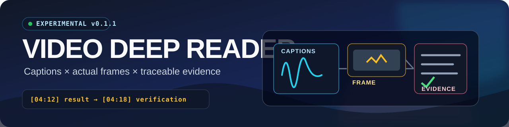
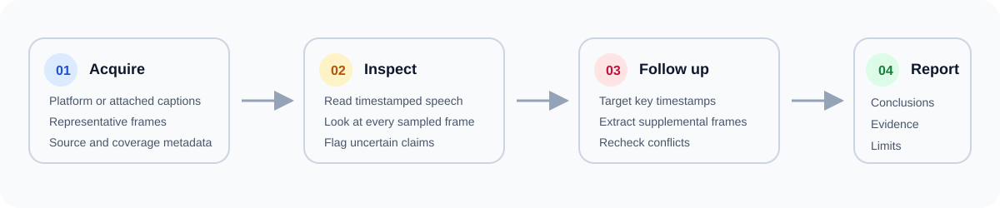

<p align="center">
  
</p>

<p align="center">
  <a href="https://github.com/yuluoliuli/video-deep-reader/actions/workflows/test.yml"></a>
  <a href="https://github.com/yuluoliuli/video-deep-reader/releases"></a>
  
  <a href="./LICENSE"></a>
</p>

<p align="center">
  <strong>Read the video. Check the evidence. Keep the receipts.</strong><br>
  面向 Codex 等 Agent：把 B站或本地视频变成可回看的时间戳字幕、实际画面和证据化解读。
</p>

> [!IMPORTANT]
> **Experimental v0.1.1.** 素材获取成功不代表视频结论已经被验证。最终报告必须注明实际看过哪些字幕和画面，以及仍有哪些限制。

## 为什么不是普通视频总结

| 普通字幕总结 | Video Deep Reader |
|---|---|
| 只读口播 | 字幕与画面联合阅读 |
| 容易漏掉图表、操作和结果页 | 默认观看全片代表帧，再按问题补帧 |
| 把作者说法当成结论 | 区分作者说法、实际画面、模型推断和外部核实 |
| 一个“完整度 100%”就结束 | 时间覆盖率、缺失状态和未核验部分分别记录 |
| 自动清理临时文件 | 默认保留全部素材与失败残片 |

它尤其适合检查评测视频有没有对照实验、教程是否展示了成功结果、字幕有没有识别错产品名，以及“完成 100%”的总结卡片究竟证明了什么。



## 能做什么

- B站 BV、视频链接、指定单 P，以及本地视频配 JSON / SRT / VTT 字幕。
- 平台字幕优先；默认提取 12 张全片代表帧，支持 `HH:MM:SS` 定向补帧。
- 生成字幕、元信息、帧清单、时间覆盖率和状态，原始字幕保持不变。
- 当前 Agent 负责分析，不要求额外 LLM API。
- 不绕过登录、付费、地区或版权限制；无追更、定时任务、自启或自动删除。

## 快速开始

### 1. 安装

需要 Python 3.10+、PATH 中的 FFmpeg 和 ffprobe。采集脚本只使用 Python 标准库。

```sh
git clone https://github.com/yuluoliuli/video-deep-reader.git \
  ~/.agents/skills/video-deep-reader
```

Codex 也可使用 `~/.codex/skills/video-deep-reader`。其他宿主需要支持读取 `SKILL.md`、执行 Python 和查看图片；DSH 兼容性尚未完成界面验收。

### 2. 向 Agent 提出带证据的问题

```text
用 video-deep-reader 解读这个视频。
重点检查作者关于速度和 Token 节省的结论有没有对照数据，
列出实际看过的画面、时间点和不能证明的部分。
链接：<视频链接>
```

### 3. 或直接采集素材

```sh
python -X utf8 scripts/read_video.py BV1toJR6HEVy --out ./runs/example
python -X utf8 scripts/read_video.py "https://www.bilibili.com/video/BV1toJR6HEVy/?p=1" --out ./runs/page-one
python -X utf8 scripts/read_video.py ./video.mp4 --subtitle ./captions.srt --out ./runs/local
```

<details>
<summary>用现有视频和字幕定向补帧</summary>

```sh
python -X utf8 scripts/read_video.py ./runs/example/video-only.mp4 \
  --frames-only --frames 0 \
  --times "02:42,03:11" \
  --subtitle ./runs/example/segments.json \
  --out ./runs/focus
```

</details>

<details>
<summary>常用参数</summary>

| 参数 | 用途 |
|---|---|
| `--page N` | 指定分 P，优先于 URL 的 `p` |
| `--frames N` | 代表帧数量，默认 12，最大 48；`0` 表示不抽帧 |
| `--times "00:30,02:42"` | 追加关键时间点 |
| `--subtitle PATH` | 使用现有 JSON / SRT / VTT 字幕 |
| `--cookie-file PATH` | 使用已有、经授权的 B站凭据 |
| `--max-mb N` | 下载上限，默认 500MB |
| `--frames-only` | 不复用完整采集流程，只从本地视频补帧 |

</details>

## 输出契约

```text
runs/example/
├── metadata.json       # 来源、标题、UP 主、分P、时长
├── segments.json       # 原始字幕片段及时间戳
├── transcript.txt      # 便于阅读的时间戳字幕
├── frames.json         # 帧时间、文件、附近字幕、核验状态
├── frames/*.jpg        # 实际代表帧与补充帧
├── video-only.mp4      # 仅视频流，用于抽帧；不含音轨
└── manifest.json       # 状态、覆盖率、警告、失败信息
```

| 状态 | 退出码 | 含义 |
|---|---:|---|
| `acquired` | 0 | 素材采集完成；仍需 Agent 读字幕、看图并写分析 |
| `partial` | 2 | 有缺失；报告可以回答的部分，并明确限制 |
| `failed` | 1 | 采集失败；保留已有素材和脱敏错误 |

`analysis.md` 与 `visual-evidence.md` 由宿主 Agent 按技能指令创建。采集脚本本身不会生成或包装结论。

## 证据长什么样

| 时间 | 类型 | 观察 | 能证明 | 不能证明 |
|---|---|---|---|---|
| `02:42` | 作者说法 | 提出执行两项任务 | 演示目标 | 两项都已完成 |
| `03:11` | 实际画面 | 页面正在翻动 | 页面确实出现 | 数据覆盖全部字段 |
| `04:12` | 实际画面 | 结果页与统计表 | 产出过结果和缺失记录 | 数据没有错误 |
| `06:13` | 模型推断 | 示例表单用于讲解接管 | 视频提出了这一概念 | 真实站点测试成功 |

时间覆盖率只说明字幕覆盖了多长时间，不说明字幕文字准确。没有“理解视频 100 分”。

## 已验证与尚未验证

已通过：

- Windows / Python 3.14 / FFmpeg 的本机实测。
- 一个 7 分 40 秒 B 站视频：225 段时间戳字幕、99.88% 时间覆盖、13 张实际查看的代表与补充帧。
- 本地视频复用与定向补帧。
- 8 项离线行为测试，以及 GitHub Actions 的 Ubuntu / Windows、Python 3.10 / 3.13 矩阵。
- 凭据仅发送到 HTTPS B站 API；重定向时剥离 `Cookie` 与 `Authorization` 头。

尚未验证：

- b23.tv 短链的真实下载流程。
- 所有 B站视频、地区、账号权限和风控状态。
- DSH 界面中的自动触发与图片查看能力。
- 无字幕时自动 ASR；当前实现要求外挂字幕或经授权的后续转写。

## 安全与隐私

- 凭据可以被显式传入，但不会复制到输出、日志或仓库。
- 视频、字幕、帧和私人媒体默认保留在本地；不要提交到公开 issue。
- 本工具不实现删除逻辑，也不会自动清理失败残片。
- 只处理你有权访问和使用的内容；请不要用 issue 上传受版权保护的完整视频。
- 安全入口见 [SECURITY.md](./SECURITY.md)。

## 仓库结构

```text
.
├── SKILL.md                  # Agent 工作流与决策规则
├── scripts/read_video.py     # 无 LLM 的素材采集器
├── scripts/test_read_video.py
├── references/               # 分析方法、来源与上游许可证
├── agents/openai.yaml        # Codex 技能展示元数据
└── .github/                  # CI、CodeQL 与 issue 模板
```

## 开发

```sh
python -X utf8 scripts/test_read_video.py
python -X utf8 scripts/read_video.py --help
```

提交规范与测试要求见 [CONTRIBUTING.md](./CONTRIBUTING.md)，版本变化见 [CHANGELOG.md](./CHANGELOG.md)。

## 来源与许可

原创实现以 [MIT](./LICENSE) 发布。设计参考 [bilibili-video-reader](https://github.com/yichen11818/bilibili-video-reader) 与 [video-digest-skill](https://github.com/coocA-Alex/video-digest-skill)。没有复制前者源码；后者 MIT 归属与许可证保留在 [references](./references/sources.md)。
